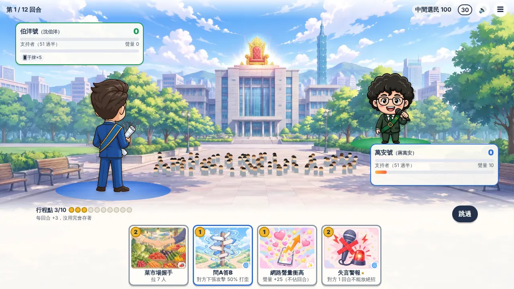
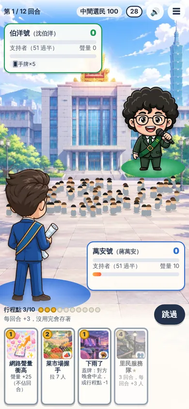

# 藍綠攻防戰 · Blue–Green Showdown

**A 1v1 political-satire card game about the 2026 Taipei mayoral race, playable in the browser.**
Two original chibi mascots — Little Wayne / 萬安號 (blue camp) and Little Puma / 伯洋號 (green camp) — compete in front of Taipei City Hall to win over 100 undecided voters. First to 51 supporters wins.

▶ **Play in English:** https://bluegreen-duel.pages.dev/?lang=en　·　**中文版：** https://bluegreen-duel.pages.dev/?lang=zh　·　[繁體中文說明](#繁體中文)

> Satire for entertainment. Not made by or affiliated with any candidate, party, or campaign; nothing in the game represents what any real person said or did. The mascots are original cartoon characters, and all artwork is AI-generated.

<p>
  
  
</p>

## Highlights

- **Bluff and challenge.** Any card can be played face down and declared as any other card. The opponent has 8 seconds to call the bluff: a caught bluffer loses 5 supporters; a wrong challenge costs the challenger 3.
- **One card per turn, saved action points.** Each turn you play one main card (or skip and bank your action points, up to 10). Magic cards, special moves and the hype burst don't use up the turn.
- **A living crowd.** 100 tiny voters on a canvas walk over to whichever side wins them.
- **A computer opponent that learns you.** It makes expected-value decisions, remembers how often you bluff and challenge, and asks the Jev decision model whether this particular declaration looks like a bluff.
- **Online play.** Random matchmaking (with a 30-second countdown that falls back to the computer) and 5-character private rooms. The server is authoritative: hidden cards and RNG state never reach the opponent's browser.
- **Netizen voice.** All flavour text is written as anonymous PTT-style comments (推／噓／→) or Threads-style posts — never as words of a real person.
- **English and Traditional Chinese.** Browsers without Chinese get English automatically; `?lang=en` / `?lang=zh` or the link on the title screen switches and is remembered. Cards, crowd comments, rules and privacy text are all translated; rules and balance are identical, and English and Chinese players can play each other online.
- **Two layouts.** 9:16 for phones, 16:9 for desktops, tablets and embedded TV frames (from 640×360 up).
- **Election-law safeguards.** The whole site closes on voting day (2026-11-28, Taipei time); no poll content; no calls to vote.

## How the Jev decision model is used

[Jev](https://typesafe.ai) (TypeSafe, `jev-1.14.0`) answers typed questions with calibrated probabilities. The rule throughout this project is **Jev judges, code decides**: every threshold and action lives in our code, and a failed call is never treated as an answer.

| Where | What Jev is asked | What the code does with it | If Jev fails |
|---|---|---|---|
| Computer opponent | "Is this face-down card a bluff?" (game numbers only) | Blends it with the player's history to decide whether to challenge | Uses history alone |
| Adaptive difficulty | "Is the player frustrated?" / "Is the computer too easy?" (last 8 games' results) | Moves the computer one of 4 levels easier or harder | Simple streak rule |
| Nickname moderation | Impersonation, officials, insults, slurs, calls to vote | Blocks at ≥ 0.5; cached 7 days | Keyword filter only |
| Contact inbox (AgentMail) | 8 yes/no questions + an urgency score 0–3 | Level 3/2 forwarded to the author at once; level 1 in a 9 pm digest; level 0 labelled | Forwarded for a human to check |
| In-game "report a problem" | Same questions as the inbox | Same routing | Kept for the digest |
| Bot detection | "Does this reaction-time pattern look scripted?" (timing statistics only) | ≥ 0.7 → human verification (Turnstile) or a 30-minute online cooldown | No flag |
| Pre-deploy content check | Quotes put in real people's mouths, mocking looks/family/health, demeaning groups, calls to vote, plus how hard each side is teased | Blocks the deploy at ≥ 0.7; warns if one camp is teased > 30% more | Warning only |
| Topical cards | Extra checks: accusing a real person of wrongdoing, mentioning polls | Blocks at ≥ 0.5 | Warning only |

All questions, state builders and decision rules are in [`worker/src/jev.js`](worker/src/jev.js). Nothing sent to Jev includes IP addresses or player IDs; nickname text and message text are sent only for moderation and triage, as stated in the in-game privacy notice.

## Architecture

```
Browser ──► Cloudflare Pages (site/) ──► Pages Function /api/* ──► Worker "bluegreen-duel-server"
                                                                  ├─ Lobby  (Durable Object: matchmaking)
                                                                  ├─ Room   (Durable Object: one per game, WebSocket Hibernation API)
                                                                  ├─ JevGate (Durable Object: rate limits, daily cap, flags, reports)
                                                                  └─ Cron: inbox triage every 5 min, digest daily 21:00 Taipei
                                                                        ├─► TypeSafe Jev
                                                                        └─► AgentMail
```

- The rules engine ([`site/js/engine.js`](site/js/engine.js)) is pure, JSON-serialisable and seeded, and is shared by the browser, the server and the Node simulators.
- No framework: HTML, CSS and ES modules; Canvas 2D for the crowd; Web Audio for synthesised sound effects.

## Repository layout

| Path | Contents |
|---|---|
| `site/` | The website (Pages output): UI, rules engine, AI opponent, cards, chatter, topical cards, art; `site/js/i18n.js` holds the English text |
| `functions/api/` | Pages Function that proxies `/api/*` (including WebSockets) to the Worker |
| `worker/` | Worker + Durable Objects, Jev integration, inbox triage |
| `tools/` | Balance simulator, content and topical-card checks, browser tests |
| `docs/` | Topical-card guide (Chinese), screenshots |
| `.github/workflows/deploy.yml` | Quality gates and deployment |

## Quality gates (run on every push to `main`)

1. **Balance simulation** — 1,000 computer-vs-computer games including all topical cards; the deploy stops if either side wins outside 40–60%. (Latest 3,000-game run: blue 50.7% / green 49.3%, first player 50.5%.)
2. **Topical-card check** — dates, sources, expiry by 2026-11-27, and blue/green pairs with identical cost and effect.
3. **Jev content check** — see the table above; the English card text and crowd comments are checked with the same rules.
4. Deploy the Worker, write secrets, deploy Pages.

## Run locally

```bash
cd worker && npx wrangler dev --port 8787        # game server
npx wrangler pages dev site --port 8788          # website (proxies /api to 8787)

node tools/sim.mjs 1000          # balance simulation
node tools/ease_test.mjs 600     # difficulty levels really get weaker
node tools/news_check.mjs        # topical-card rules
python3 tools/pvp_test.py        # matchmaking, reconnects, private rooms
python3 tools/challenge_test.py  # bluffing and challenges, hidden cards stay hidden
python3 tools/fx_test.py         # a full game against the computer
```

## Configuration

**Repository secrets:** `CLOUDFLARE_API_TOKEN`, `CLOUDFLARE_ACCOUNT_ID`, `TYPESAFE_API_KEY`, `AGENTMAIL_API_KEY`, `NOTIFY_EMAIL`.

**Runtime switches** (Cloudflare dashboard → Worker `bluegreen-duel-server` → Variables; no redeploy needed):

| Variable | Effect |
|---|---|
| `MAINTENANCE=1`, `MAINTENANCE_MSG` | Maintenance page, no new games |
| `DISABLED_CARDS` | Comma-separated card ids to remove from play |
| `JEV_DISABLED=1` | Turn every Jev feature off; `JEV_DAILY_CAP` (default 50,000) and `JEV_PER_IP_PER_MIN` (default 20) |
| `TURNSTILE_SITE_KEY` + secret `TURNSTILE_SECRET` | Enable human verification for flagged players |

## Embedding

The site may be embedded only by [encore.taipei](https://encore.taipei) (`frame-ancestors`); every other site is blocked. Inside that TV frame, the remote's volume controls sound effects, colour keys open screens (🔴 how to play, 🟢 menu, 🟡 report, 🔵 mute — they never play a card for you), and ← → change channel. The embedded game defaults to Chinese; add `?lang=en` to the embed URL for English.

## Content rules and privacy

- No quotes or invented words attributed to real people; no mocking of looks, family or health; no slurs against either camp's supporters; no calls to vote; blue and green cards are mirrored in cost and strength.
- No registration. Nicknames, game state and reports are kept only as long as needed (games: about a minute after they end; nickname checks: 7 days; reports: up to 7 days; bot flags: up to 24 hours). IP addresses are only held as a hash with a daily salt. Play-style statistics stay in the player's browser.

## Tools and credits

Claude (development) · TypeSafe Jev (decision model) · Higgsfield (AI artwork) · Cloudflare Pages, Workers, Durable Objects, Turnstile · GitHub Actions · AgentMail (contact inbox) · Node.js, Playwright and Pillow (testing and asset processing).

## License

Noncommercial use only. © 2026 Josh Tsai

- **Code:** [PolyForm Noncommercial 1.0.0](LICENSE) — free for personal, educational, research and other noncommercial use.
- **Artwork and game text** (mascots, card art, card text, crowd comments, videos): [CC BY-NC 4.0](LICENSE-ASSETS.md).
- **Commercial use** requires a separate license: bluegreen-duel@agentmail.to.
- Versions published before 2026-10-28 were MIT-licensed; copies obtained under those versions keep those terms.

---

## 繁體中文

**藍綠攻防戰**是以 2026 台北市長選舉為題的網頁 1v1 政治諷刺卡牌遊戲。藍綠雙方各派一隻原創 Q 版吉祥物（萬安號、伯洋號），在市府前廣場用卡牌拉攏 100 位中間選民，先過半（51 人）的人贏。

▶ **立即玩：** https://bluegreen-duel.pages.dev

> 政治諷刺娛樂，非任何候選人、政黨或競選團隊製作，內容不代表當事人言行。角色為原創 Q 版人偶，美術由 AI 生成。

### 特色
- **蓋牌吹牛與質疑**：任何手牌都能蓋著打出、宣告成另一張牌；對手 8 秒內決定要不要質疑。吹牛被抓 -5 人，質疑錯 -3 人。
- **一回合一張牌、行程點存錢制**：每回合打一張主牌，或跳過把行程點存起來（上限 10）；魔法卡、大絕招、聲量爆表不佔回合。
- **會換邊站的群眾**：100 個小人跟著支持者人數走到各自陣營。
- **會學習的電腦對手**：期望值決策、記住你吹牛與質疑的習慣，並請 Jev 判斷這次像不像吹牛。
- **線上對戰**：隨機配對（30 秒沒配到改跟電腦）與 5 碼朋友房；伺服器權威，蓋牌與亂數不會外傳。
- **鄉民口吻**：卡牌台詞都是匿名 PTT 推文或脆文，不是任何真人說的話。
- **中英雙語**：瀏覽器語言沒有中文時自動顯示英文；網址加 `?lang=en`／`?lang=zh` 或首頁的語言連結可切換並記住。卡牌、群眾留言、規則、隱私聲明都有英文；規則與平衡完全相同，中英文玩家可以互相連線對戰。嵌在台北安可電視台時預設中文。
- **雙版面**：手機 9:16；電腦、平板、電視台小畫框 16:9（640×360 起）。
- **選罷法**：投票日（2026-11-28，台北時間）全站關閉；沒有民調內容、沒有投票呼籲。

### Jev 判斷模型的用途
原則是「**Jev 判斷，程式決定**」：門檻與動作都寫在程式裡，Jev 失敗一律不當成答案。

| 用途 | 程式怎麼處理 | Jev 失敗時 |
|---|---|---|
| 電腦對手猜吹牛 | 與玩家歷史紀錄加權，決定要不要質疑 | 只用歷史紀錄 |
| 電腦自動放水 | 依「快放棄了／太好打」升降一級（共 4 級） | 改用連勝連敗規則 |
| 暱稱審核 | ≥ 0.5 擋下，快取 7 天 | 只用關鍵字 |
| 聯絡信箱分流 | 緊急度 3、2 級即時轉寄作者；1 級晚上 9 點彙整；0 級只貼標籤 | 轉寄給作者確認 |
| 遊戲內回報問題 | 同信箱分流 | 留到彙整 |
| 防機器人 | ≥ 0.7 要求真人驗證或暫停線上對戰 30 分鐘 | 不標記 |
| 部署前內容審查 | 合規 ≥ 0.7 停止部署；藍綠被酸差距 > 30% 警告 | 只警告 |
| 時事卡 | 另審「指控真人」「提到民調」，≥ 0.5 擋下 | 只警告 |

問題、狀態與規則都在 [`worker/src/jev.js`](worker/src/jev.js)。送給 Jev 的資料不含 IP 或玩家識別碼；暱稱與信件、回報內容只在審核與分流時送出，並寫在遊戲內隱私聲明。

### 部署與設定
- 推到 `main` 自動執行：平衡模擬（勝率超出 40–60% 停止）→ 時事卡格式檢查 → Jev 內容審查 → 部署 Worker 與 Pages。
- Repo secrets：`CLOUDFLARE_API_TOKEN`、`CLOUDFLARE_ACCOUNT_ID`、`TYPESAFE_API_KEY`、`AGENTMAIL_API_KEY`、`NOTIFY_EMAIL`。
- 不用重新部署的開關（Cloudflare 後台 Worker 變數）：`MAINTENANCE`、`MAINTENANCE_MSG`、`DISABLED_CARDS`、`JEV_DISABLED`、`JEV_DAILY_CAP`、`JEV_PER_IP_PER_MIN`、`TURNSTILE_SITE_KEY`＋`TURNSTILE_SECRET`。
- 時事卡新增方式見 [`docs/時事卡.md`](docs/時事卡.md)。
- 只允許 [台北安可電視台](https://encore.taipei) 以 iframe 嵌入；支援遙控器音量、彩色鍵與 ← → 轉台。

### 內容界線與隱私
- 不引用或捏造真人發言；不嘲笑外貌、家人、健康；不用陣營蔑稱；不呼籲投票；藍綠卡牌費用與強度一一對應。
- 不需註冊。對局資料結束約 1 分鐘後刪除；暱稱審核結果保存 7 天；回報最多 7 天；可疑標記最多 24 小時；IP 只以每日換鹽的雜湊值暫存；出牌習慣統計只存在玩家瀏覽器。

### 授權
僅限非商業使用。© 2026 Josh Tsai
- **程式碼**：[PolyForm Noncommercial 1.0.0](LICENSE)，個人、教學、研究等非商業用途可自由使用、修改與散布。
- **美術與遊戲文字**（吉祥物、卡圖、卡牌文字、群眾留言、宣傳影片）：[CC BY-NC 4.0](LICENSE-ASSETS.md)。
- **商業使用**須另行取得授權：bluegreen-duel@agentmail.to。
- 2026-10-28 以前發布的版本為 MIT 授權，依當時版本取得的副本仍適用 MIT。
